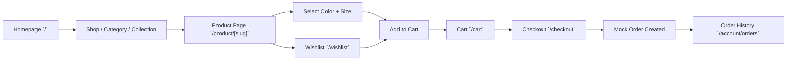

## 1. Product Overview

Annah Boutique is a premium Indian fashion e-commerce boutique offering curated ethnic and contemporary women's apparel including sarees, kurtis, dresses, co-ord sets, party wear, and festive collections. The platform delivers a luxury online shopping experience with elegant product discovery, seamless checkout, and personalized wishlist/cart functionality.

- **Target Users**: Fashion-conscious women aged 22–45 across India and global diaspora, seeking premium quality ethnic wear with modern design sensibility.
- **Market Value**: Fills the gap between mass-market marketplaces and luxury designer portals, providing a boutique identity with trust, curation, and WhatsApp-enabled customer support.

---

## 2. Core Features

### 2.1 User Roles

| Role | Registration Method | Core Permissions |
|------|---------------------|------------------|
| Guest Visitor | None (browse anonymously) | Browse catalog, search, filter, view products, add to wishlist/cart via localStorage |
| Registered User | Email + password registration (mock) | All guest features + account dashboard, order history, saved addresses, mock checkout |

### 2.2 Feature Module

1. **Homepage**: Announcement bar, sticky header, hero banner, category showcase, new arrivals, featured collection, promo banner, trending products, style inspiration, Instagram feed, about blurb, newsletter, footer.
2. **Catalog (Shop/Category/Collection)**: Sidebar filters, product grid, sort toolbar, search integration, pagination, empty state, product count.
3. **Product Detail**: Multi-image gallery with zoom, variants (color/size), size chart, ratings, quantity selector, Add-to-Cart, Buy Now, Wishlist, WhatsApp enquiry.
4. **Search**: Results page with URL query params, lightweight suggestions across name/category/collection/tags.
5. **Cart**: Add/remove/update quantity, variants, subtotal/discount, empty state, persisted in localStorage.
6. **Wishlist**: Add/remove/move-to-cart, persisted in localStorage.
7. **Checkout**: Multi-step form — customer info, shipping, delivery method, payment method, order summary, mock order creation.
8. **Auth (Mock)**: Login / Register / Logout / Current user session in localStorage.
9. **Account**: Dashboard, order history with mock orders.
10. **Informational**: About, Contact, static content pages.
11. **WhatsApp CTA**: Floating button, product enquiry, contact CTA with prefilled message.

### 2.3 Page Details

| Page Name | Module Name | Feature description |
|-----------|-------------|---------------------|
| `/` | Hero | Desktop/mobile image, headline, subcopy, primary + secondary CTA, data-driven content |
| `/` | Category Showcase | 8 category cards from data, hover zoom, category page links |
| `/` | New Arrivals | 8 product cards filtered by collection `new-arrivals` |
| `/` | Featured Collection | Prominent section for `festive-edit`/`party-wear` collection |
| `/` | Trending Products | `isTrending` products with trending badge |
| `/shop` | Filter Sidebar (Desktop) | Category, price range, size, color, collection, availability, discount — all URL-synced |
| `/shop` | Sort Toolbar | Featured / Newest / Price Low↕High / Popular / Discount |
| `/shop` | Product Grid | Responsive 2/3/4-col grid with `<ProductCard>` reuse |
| `/shop` | Mobile Filter Drawer | Accessible bottom-sheet filters |
| `/category/[slug]` | Category Page | Same layout as Shop, pre-filtered by category slug, SEO metadata |
| `/collection/[slug]` | Collection Page | Same layout as Shop, pre-filtered by collection slug, hero banner per collection |
| `/product/[slug]` | Image Gallery | Thumbnails, zoom, mobile swipe, image priority for first image |
| `/product/[slug]` | Variant Select | Color + size swatches, stock indicator, unavailable disabled |
| `/product/[slug]` | CTA Block | Sticky Add to Cart on mobile, Buy Now, Wishlist, WhatsApp enquiry |
| `/search` | Search Results | `?q=` param, results grid, suggestions, "no results" state |
| `/wishlist` | Wishlist Page | List/grid, remove, move to cart, empty state |
| `/cart` | Cart Page | Line items, qty controls, subtotal, discount, proceed to checkout |
| `/checkout` | Multi-Step Checkout | 5 steps with validation-like UX, mock submit, order ID |
| `/login` | Login | Email + password form, mock auth, register redirect |
| `/register` | Register | Name + email + password form, mock user creation |
| `/account` | Account Dashboard | Welcome, quick links |
| `/account/orders` | Order History | Mock orders list, order IDs, statuses, line items |
| `/about` | About Page | Brand story, imagery, values |
| `/contact` | Contact Page | Contact form, phone, email, WhatsApp, address |

---

## 3. Core Process

**Main shopping flow (guest or logged-in user):**

1. Visitor lands on `/` → views hero, categories, featured sections.
2. Navigates to `/shop` or a `/category/[slug]` → applies filters via sidebar/mobile drawer (URL updates).
3. Opens `/product/[slug]` → browses gallery, picks color + size, checks stock.
4. Clicks **Add to Cart** → cart updates, counter badge increases.
5. Optional: taps **Wishlist** heart → saved for later.
6. Goes to `/cart` → reviews line items, adjusts quantity, sees subtotal + discount.
7. Proceeds to `/checkout` → fills customer info → shipping address → delivery method → payment method → reviews summary → clicks Place Order.
8. Mock order created with ID `ANB-xxxxx` → redirects to `/account/orders` with success toast.

---

## 4. User Interface Design

### 4.1 Design Style

**Aesthetic direction: Premium / Feminine / Editorial / Modern Indian Luxury.**

- **Primary Palette** (Tailwind tokens via CSS variables):
  - Primary: Soft rose / dusty blush `#C08B7E` → deep rosewood `#8B4A5C` accents
  - Secondary: Warm cream `#FBF5EE` as page background
  - Accent: Gold-brass `#B8935A` for badges, underlines, CTA borders
  - Muted: Taupe `#7A7265` for secondary text
  - Success: Deep sage `#4A7C59`
  - Error: Rich coral `#C75146`
  - Border: Subtle warm sand `#E8DDD0`
- **Button style**: Soft pill shape (rounded-full for CTAs, rounded-lg for UI), subtle 0.3px gold border for primary, elegant 100ms micro-interactions on hover/focus.
- **Typography (next/font)**:
  - Display: `Cormorant Garamond` (serif, headings, prices — elegant, editorial).
  - Body: `Inter` (clean, accessible UI text) or `Lato`.
  - Handwritten accent tagline: `Dancing Script` (minimal usage — only brand tagline).
- **Layout style**: Editorial asymmetric grid on homepage hero, structured card grid for catalog, generous whitespace, thin dividers, subtle drop shadows on hover.
- **Icons**: Lucide React (line icons, 1.5px stroke) with custom gold/rose accent on active.
- **Micro-interactions**: Image crossfade on `<ProductCard>` hover, heart fill animation for wishlist, drawer slide-in, toast fade-up, product page gallery thumbnail border highlight.

### 4.2 Page Design Overview

| Page Name | Module Name | UI Elements |
|-----------|-------------|-------------|
| Home | Hero | Full-width, desktop 16:9 / mobile 4:5 image, oversized serif headline left-aligned, overlay gradient, floating gold-outline buttons |
| Home | Categories | 4x2 card grid, each with image, category name overlay, diagonal reveal on hover |
| Home | Product Sections | 4-col grid, NEW / SALE / TRENDING / BESTSELLER corner pills (rounded-full, uppercase, serif-free) |
| Shop | Filter Sidebar | Sticky left column, section accordions, checkbox groups, price range slider, apply/reset |
| Product | Gallery | 2-col desktop (thumb col + main image), full-width mobile with dot indicators, zoom lens on hover |
| Product | CTA Sticky | Mobile bottom bar: fixed, backdrop-blur, wishlist heart left, ATC right, buy-now full-width below |
| Cart | Line Items | Image + name + variant + qty stepper + price stacked vertically on mobile, side summary card desktop |
| Checkout | Steps | Top progress stepper with gold dot indicators, left column form, right sticky summary |
| Footer | 4-column | Shop / Information / Social / Newsletter, thin divider links, centered copyright + WhatsApp fab |

### 4.3 Responsiveness

- **Design order: Desktop-first, mobile-adaptive.** Breakpoints: `sm 640`, `md 768`, `lg 1024`, `xl 1280`, `2xl 1536`.
- **Mobile key behaviors**:
  - Sticky header with hamburger, logo, search, wishlist, cart icons.
  - Accessible full-height navigation drawer.
  - Filter → bottom sheet modal, Sort → inline dropdown select.
  - Product gallery full-width with swipe.
  - Sticky Add to Cart / Buy Now bar at bottom.
  - Touch targets ≥ 44×44 px.
- **Touch optimizations**: Swipe for gallery, no-hover fallbacks for product image swap, enlarged checkbox/radio on forms.

### 4.4 Imagery & Assets Guidance

- Product images: 2–3 angles per SKU, WebP format, placed under `/public/products/` with consistent lighting (soft, warm, model-shot for apparel).
- Category banners: `/public/categories/`.
- Hero & promo banners: `/public/banners/`.
- Logo: `/public/logo/` (primary SVG + favicon).
- Use the in-IDE text-to-image endpoint to generate 30–50 realistic Indian fashion visuals with varied categories, colors, and compositions.
