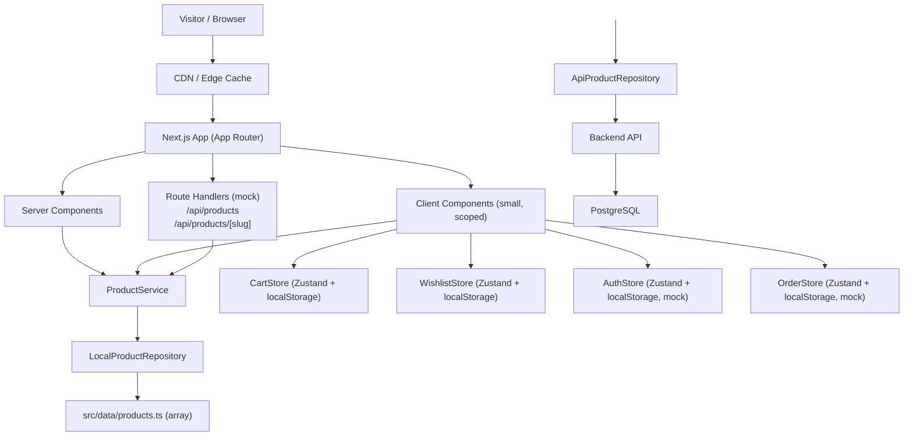
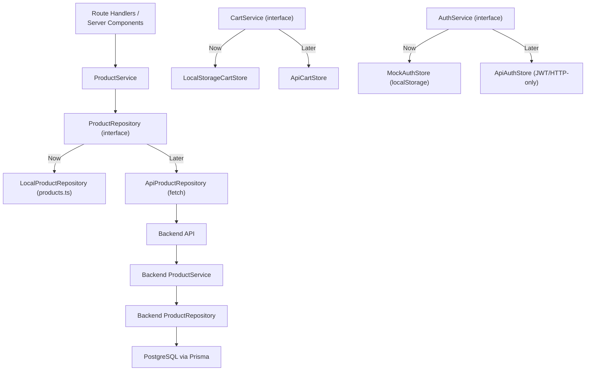
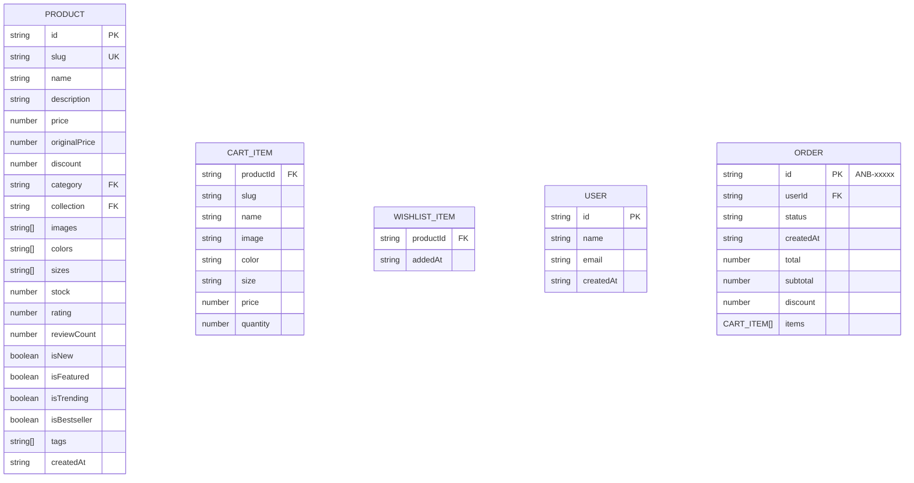

## 1. Architecture Design



**Key architectural constraint: The UI layer calls `ProductService` / service interfaces only. When switching repository implementations (local → API), UI code is unchanged.**

---

## 2. Technology Description

| Layer | Choice | Rationale |
|-------|--------|-----------|
| Framework | Next.js 15 (App Router) latest stable | SSR/ISR/Edge, RSC by default, Metadata API, generateStaticParams |
| Language | TypeScript 5 (strict) | End-to-end type safety for product/cart/service contracts |
| UI Styling | Tailwind CSS 3 + CSS variables (design tokens) + `next/font` | CDN-cacheable static CSS, tiny client bundles, themeable via tokens |
| UI Primitives | shadcn/ui (Radix primitives) for Dialog, Drawer, Accordion, Select, Sheet, Toast | Accessibility baked-in, composable, lazy scope |
| State mgmt | Zustand (persist middleware) for Cart/Wishlist/Auth/Orders; URL searchParams for filters/sort/search | Minimal, tree-shakable; URL state = shareable + SSR-friendly |
| Image | `next/image` (WebP/AVIF, responsive sizes, priority flag for LCP) | Core Web Vitals, auto-optimization |
| Icons | `lucide-react` | Light, tree-shakable, consistent stroke |
| Testing (unit) | Vitest + `@testing-library/react` | Fast ESM-native, matches Vite/Next bundler |
| Testing (E2E) | Playwright | Cross-browser, reliable shopping journeys |
| Linting | ESLint (Next core-web-vitals ruleset) + Prettier | Enforce accessibility/performance rules |

- **Initialization**: `npx create-next-app@latest` with TypeScript + Tailwind + App Router + ESLint + src/ directory.
- **No database / backend** in this phase. Mock data only.

---

## 3. Route Definitions

| Route (App Router `app/`) | Rendering | Purpose |
|----------------------------|-----------|---------|
| `/` (`page.tsx`) | ISR (revalidate 3600) | Homepage — hero, categories, featured, trending |
| `/shop` (`page.tsx`) | SSR + searchParams | Catalog with filters via URL, full grid |
| `/category/[slug]` | SSG (`generateStaticParams`) + ISR | Products filtered by category slug |
| `/collection/[slug]` | SSG (`generateStaticParams`) + ISR | Products filtered by collection slug with collection banner |
| `/product/[slug]` | SSG (`generateStaticParams`) + ISR | PDP — gallery, variants, CTA |
| `/search` | SSR + searchParams (`?q=`) | Search results + suggestions |
| `/wishlist` | Client Component wrapper inside RSC layout | Persisted via Zustand + localStorage |
| `/cart` | Client Component wrapper | Cart line items + totals |
| `/checkout` | Client Component (multi-step form) | Mock checkout flow |
| `/about` | Static | Brand story |
| `/contact` | Static + contact form (mock submit) | Contact info + WhatsApp CTAs |
| `/login` | Client Component | Mock login form |
| `/register` | Client Component | Mock register form |
| `/account` | RSC + auth guard client wrapper | Dashboard |
| `/account/orders` | RSC + auth guard client wrapper | Mock order history |
| `/api/products` | Route Handler (GET) | Mock API: returns all products JSON |
| `/api/products/[slug]` | Route Handler (GET) | Mock API: returns single product by slug |
| `/api/search` | Route Handler (GET) | Mock API: lightweight search |
| `error.tsx` (root + app-level) | — | Error boundaries with fallback UI |
| `not-found.tsx` | — | 404 with CTA to home |
| `loading.tsx` (per segment) | — | Skeleton fallbacks |

---

## 4. API Definitions (Mock Contract)

**Future backend must match these exact shapes for zero UI-change migration.**

```ts
// src/types/product.ts
export interface Product {
  id: string;
  slug: string;
  name: string;
  description: string;
  price: number;            // INR
  originalPrice: number;
  discount: number;         // 0-100 percent
  category: string;
  collection: string;
  images: string[];         // paths under /public/products
  colors: string[];
  sizes: string[];
  stock: number;            // total stock; per-variant can be added later
  rating: number;
  reviewCount: number;
  isNew: boolean;
  isFeatured: boolean;
  isTrending: boolean;
  isBestseller: boolean;
  tags: string[];
  createdAt: string;
}

export interface Category {
  slug: string;
  name: string;
  description: string;
  image: string;
}

export interface Collection {
  slug: string;
  name: string;
  tagline: string;
  description: string;
  heroImage: string;
}
```

```ts
// src/repositories/productRepository.ts
export interface ProductRepository {
  getProducts(): Promise<Product[]>;
  getProductById(id: string): Promise<Product | null>;
  getProductBySlug(slug: string): Promise<Product | null>;
  getProductsByCategory(category: string): Promise<Product[]>;
  getProductsByCollection(collection: string): Promise<Product[]>;
  searchProducts(query: string): Promise<Product[]>;
}
```

```ts
// src/services/productService.ts — filter/sort/search/pagination
export interface ProductQuery {
  category?: string;
  collection?: string;
  sizes?: string[];
  colors?: string[];
  priceMin?: number;
  priceMax?: number;
  minDiscount?: number;
  inStockOnly?: boolean;
  sort?: SortKey;
  q?: string;
  page?: number;
  limit?: number;
}

export type SortKey =
  | "featured"
  | "newest"
  | "price-asc"
  | "price-desc"
  | "popular"
  | "discount";

export interface ProductResult {
  items: Product[];
  total: number;
  page: number;
  limit: number;
}
```

**API Response envelope (all route handlers):**

```ts
interface ApiResponse<T> {
  success: boolean;
  data?: T;
  error?: { code: string; message: string };
}
```

---

## 5. Server-Layer Architecture (Future Backend Template)



---

## 6. Data Model (Frontend Mock)

### 6.1 Data Model Definition



### 6.2 Mock Data Volume

- **Products**: 30–50 realistic SKUs with Indian ethnic naming.
- **Categories (8)**: Sarees, Kurtis, Dresses, Co-ord Sets, Tops, Bottom Wear, Party Wear, Festive Wear.
- **Collections (5)**: New Arrivals, Bestsellers, Festive Edit, Party Wear Edit, Summer Edit.
- **Sizes**: XS, S, M, L, XL, XXL (Free Size where applicable).
- **Colors**: Pink, Blue, Green, Red, Beige, Maroon, Navy, Gold, Black, White, Mustard, Teal.
- **Prices**: ₹799 – ₹14,999 with discounts 0–60%.

### 6.3 Folder Structure

```
src/
├── app/
│   ├── (shop)/
│   │   ├── layout.tsx
│   │   ├── page.tsx                 # Home
│   │   ├── shop/page.tsx
│   │   ├── category/[slug]/page.tsx
│   │   ├── collection/[slug]/page.tsx
│   │   ├── product/[slug]/page.tsx
│   │   ├── search/page.tsx
│   │   ├── about/page.tsx
│   │   └── contact/page.tsx
│   ├── (cart)/
│   │   ├── cart/page.tsx
│   │   └── checkout/page.tsx
│   ├── (user)/
│   │   ├── wishlist/page.tsx
│   │   ├── login/page.tsx
│   │   ├── register/page.tsx
│   │   └── account/
│   │       ├── page.tsx
│   │       └── orders/page.tsx
│   ├── api/
│   │   ├── products/route.ts
│   │   ├── products/[slug]/route.ts
│   │   └── search/route.ts
│   ├── layout.tsx
│   ├── error.tsx
│   ├── global-error.tsx
│   ├── not-found.tsx
│   ├── loading.tsx
│   ├── sitemap.ts
│   ├── robots.ts
│   └── globals.css
├── components/
│   ├── ui/                       # shadcn primitives
│   ├── layout/
│   │   ├── AnnouncementBar.tsx
│   │   ├── Header.tsx
│   │   ├── MobileNav.tsx
│   │   ├── Footer.tsx
│   │   └── WhatsappFab.tsx
│   ├── product/
│   │   ├── ProductCard.tsx
│   │   ├── ProductGrid.tsx
│   │   ├── ProductGallery.tsx
│   │   ├── ProductVariantSelect.tsx
│   │   ├── ProductBadges.tsx
│   │   ├── ProductCardSkeleton.tsx
│   │   └── ProductGridSkeleton.tsx
│   ├── shop/
│   │   ├── FilterSidebar.tsx
│   │   ├── FilterDrawer.tsx
│   │   ├── SortToolbar.tsx
│   │   └── SearchInput.tsx
│   ├── home/
│   │   ├── Hero.tsx
│   │   ├── CategoryShowcase.tsx
│   │   ├── NewArrivals.tsx
│   │   ├── FeaturedCollection.tsx
│   │   ├── TrendingProducts.tsx
│   │   ├── StyleEdit.tsx
│   │   ├── PromoBanner.tsx
│   │   ├── InstagramFeed.tsx
│   │   └── Newsletter.tsx
│   ├── cart/
│   │   ├── CartItem.tsx
│   │   ├── CartTotals.tsx
│   │   └── CartIconBadge.tsx
│   ├── checkout/
│   │   ├── CheckoutStepper.tsx
│   │   ├── CheckoutForm.tsx
│   │   └── OrderSummary.tsx
│   ├── account/
│   │   ├── AuthForm.tsx
│   │   └── OrderHistory.tsx
│   └── skeleton/
├── config/
│   └── site.ts
├── data/
│   ├── products.ts
│   ├── categories.ts
│   ├── collections.ts
│   └── banners.ts
├── hooks/
│   ├── useFilters.ts
│   ├── useSearch.ts
│   └── useDebounce.ts
├── repositories/
│   └── productRepository.ts
├── services/
│   ├── productService.ts
│   ├── paymentService.ts   # interface + mock
│   └── authService.ts      # interface + mock
├── stores/
│   ├── cartStore.ts
│   ├── wishlistStore.ts
│   ├── authStore.ts
│   └── orderStore.ts
├── types/
│   ├── product.ts
│   ├── cart.ts
│   ├── user.ts
│   └── order.ts
└── utils/
    ├── format.ts           # currency, percent
    ├── seo.ts              # metadata builders + JSON-LD
    └── sortFilter.ts       # pure sort/filter fns (unit-testable)
```
